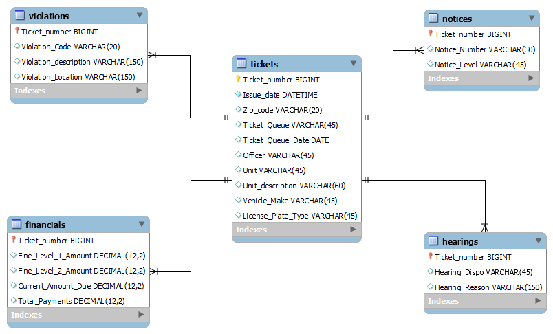
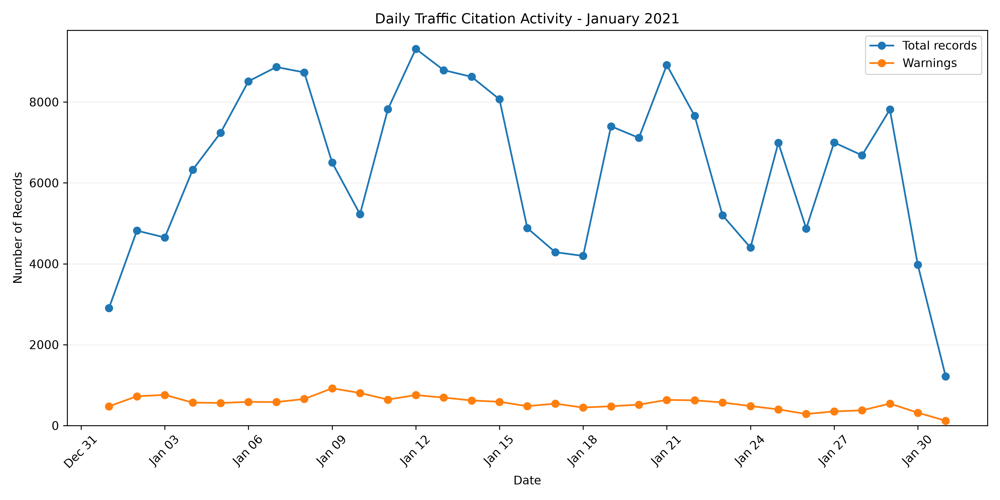
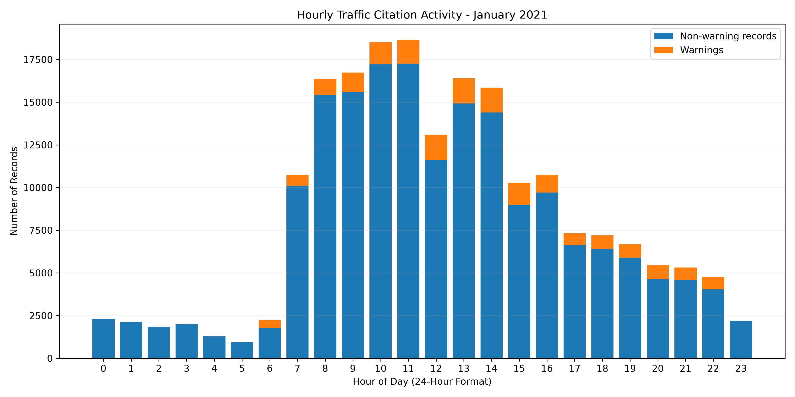
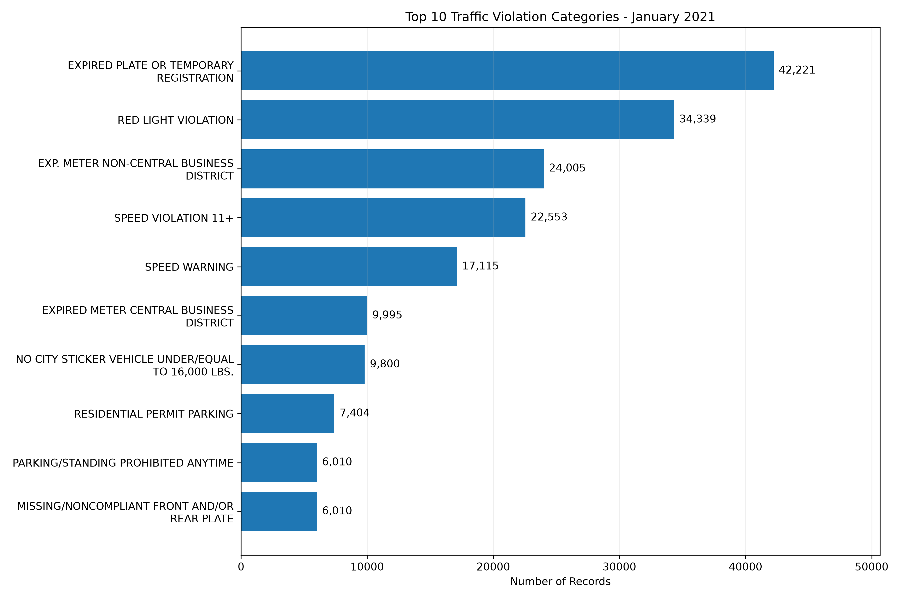
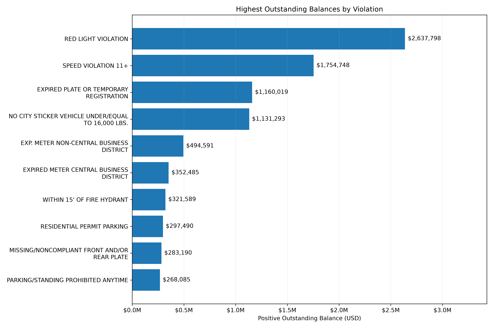

# Chicago Traffic Citation Analysis

An analysis of 198,994 traffic citation records issued in Chicago during January 2021 using Python and MySQL. This project is an extension of an undergraduate database design project. I expanded the dataset, simplified the database structure, automated data ingestion, and developed additional analyses to better understand citation patterns and payment activity.

## Dataset

The data was obtained from the [ProPublica Data Store](https://projects.propublica.org/datastore/#city-of-chicago-camera-tickets-and-warnings-data), which provides records originally collected by the Chicago Department of Finance.

- **Source file:** `FOIA_Sanchez_A50952_20210615_Year_2021.txt`
- **Original file size:** 324 MB
- **Analysis period:** January 1–31, 2021
- **Records analyzed:** 198,994
- **Source attributes:** 21

The original file uses a dollar-sign delimiter. The Python loading script extracts January records directly from the source file without requiring an intermediate CSV.

## Technologies Used

- Python
- MySQL
- MySQL Workbench
- Matplotlib
- Git and GitHub

## Database Design

The database consists of five relational tables connected through the ticket number.

| Table | Records | Description |
|---|---:|---|
| Tickets | 198,994 | Citation dates, statuses, vehicle and enforcement information |
| Violations | 198,994 | Violation codes, descriptions and locations |
| Financials | 198,994 | Fine amounts, payments and outstanding balances |
| Notices | 175,559 | Notice numbers and levels |
| Hearings | 12,323 | Hearing dispositions and reasons |

The original database design was simplified from 11 tables to five, eliminating unnecessary junction tables and artificial identifiers.

## Data Processing

The Python ETL pipeline:

1. Reads the original source file one record at a time.
2. Filters records to January 2021.
3. Converts dates and financial values into appropriate data types.
4. Separates citation information into the five database tables.
5. Inserts records into MySQL in batches of 1,000.
6. Handles incomplete notice and hearing information.

The imported data was validated against the original source to confirm record counts and financial totals.

## SQL Analysis

Ten SQL views were created to examine:

- Citations by vehicle manufacturer
- Daily citation activity
- Hourly citation activity
- Weekday and weekend activity
- Violation frequency
- Citations by ZIP code
- Financial summary by ticket status
- Financial impact by violation
- Payment participation by violation
- Hearing outcomes

## Key Findings

| Metric | Result |
|---|---:|
| Total records | 198,994 |
| Warning statuses | 17,089 |
| Total payments | $9,475,930.11 |
| Positive outstanding balances | $9,684,865.39 |
| Net outstanding balance | $9,624,840.01 |

### Citation Patterns

Average daily citation activity was approximately 62% higher on weekdays than weekends. Hourly activity peaked at 11 AM, with 18,643 records across the month.

### Violation Frequency

Expired plates and temporary registration violations were the most frequent category, accounting for 21.22% of all records, followed by red-light violations at 17.26%.

### Financial Analysis

Red-light violations and speed violations of 11+ accounted for approximately 45.35% of all positive outstanding balances.

Expired parking meter violations also had higher observed payment participation percentages than several vehicle registration and compliance violations.

Additional visualizations are available in the [figures directory](reports/figures/).

## Running the Project

1. Download the original dataset from ProPublica and place the 2021 TXT file in `data/raw/`.
2. Install the required Python packages using `python -m pip install -r requirements.txt`.
3. Execute `sql/schema.sql` in MySQL Workbench to create the database.
4. Configure a local MySQL account named `chicago_loader` with SELECT and INSERT permissions on `chicago_citations_jan2021`.
5. Run the following scripts from the repository root:

   - `python scripts/profile_source_2021.py`
   - `python scripts/load_data.py`

6. Execute `sql/analysis_queries.sql` followed by `sql/validation.sql` in MySQL Workbench.
7. Run the remaining Python scripts:

   - `python scripts/validate_source.py`
   - `python scripts/create_charts.py`

The loading script requires an empty database. Generated visualizations are saved in `reports/figures/`.

The original dataset is not included in this repository.

## Limitations

- The analysis is limited to January 2021 and does not establish long-term or seasonal trends.
- Citation counts do not account for differences in traffic volume or enforcement activity.
- Payment and balance values reflect the historical source data rather than current outstanding amounts.
- Payment participation measures whether a payment was recorded, not the percentage of collectible fines recovered.